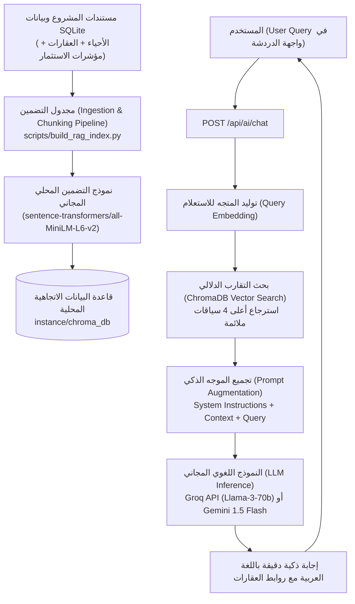

# دليل التنفيذ التفصيلي لخدمة الذكاء الاصطناعي التوليدي المعزز بالاسترجاع (Full RAG Pipeline) 🤖📚
## Blueprint for Autonomous AI Execution

> **تاريخ الإعداد:** 2026-10-13  
> **المشروع:** منصة عقار ذكي (Riyadh Real Estate Intelligence Platform)  
> **الهدف:** توجيه نموذج الذكاء الاصطناعي (أو المطور) لتنفيذ خدمة الـ RAG الكاملة خطوة بخطوة وبدون أي تكلفة مالية (Free Tier & Local Vector DB).

---

## 1. سبب عدم وجود الخدمة سابقاً والحالة الراهنة (Current State vs Target)
- في المستند الأولي `08_ai_rag_strategy.md`، كانت خدمة الـ RAG عبارة عن **تصميم نظري واستراتيجي** فقط ولم تكن مبرمجة أو مربوطة بالواجهات.
- **ما تم إنجازه حالياً (المرحلة الأولى - Active):**
  - تم بناء واجهة محادثة ذكية تفاعلية فورية (Floating Assistant Drawer) في المنصة.
  - تم ربطها بنقطة نهاية بالخلفية `POST /api/ai/chat` تعمل على فحص قاعدة بيانات SQLite (الأحياء، العقارات، الأسعار، البنية التحتية) والإجابة بذكاء عن الاستفسارات فورياً.
- **المرحلة المستهدفة (المرحلة الثانية والثالثة - Full RAG):**
  - تحويل جميع بيانات العقارات والمقالات ومخططات الرياض إلى متجهات رقمية (Embeddings) في قاعدة بيانات محلية `ChromaDB`.
  - استرجاع السياق بدقة بالبحث الدلالي (Semantic Search).
  - تمرير السياق إلى نموذج توليدي فائق (Groq Llama-3-70b أو Google Gemini Free Tier) لتقديم استشارات عقارية واستثمارية فائقة الدقة باللغة العربية.

---

## 2. الهيكلية المعمارية لنظام الـ RAG (Architecture Flow)



---

## 3. المتطلبات وحزم بايثون (Dependencies)
أضف الحزم التالية إلى ملف `requirements.txt` أو قم بتثبيتها عبر الأمر:
```bash
pip install chromadb langchain-community sentence-transformers groq google-generativeai pydantic
```

---

## 4. تعليمات التنفيذ خطوة بخطوة للذكاء الاصطناعي (Step-by-Step AI Instructions)

### الخطوة 1: إعداد متغيرات البيئة (`.env`)
تأكد من وجود مفتاح Groq مجاني أو Google Gemini API في ملف `.env`:
```env
# يمكنك الحصول على مفتاح Groq مجاني فوراً من https://console.groq.com/keys
GROQ_API_KEY=gsk_your_groq_api_key_here
# أو مفتاح Gemini من Google AI Studio:
# GEMINI_API_KEY=AIzaSy...
RAG_ENABLED=true
CHROMA_PERSIST_DIRECTORY=instance/chroma_db
```

### الخطوة 2: إنشاء وحدة الـ RAG الأساسية (`app/services/rag_service.py`)
قم بإنشاء الملف `app/services/rag_service.py` بالهيكل التالي:

```python
"""
خدمة الـ RAG الذكية لمنصة عقار ذكي
تعتمد على ChromaDB للبحث الدلالي ونموذج Groq / Gemini للتوليد
"""
import os
import chromadb
from chromadb.utils import embedding_functions

class RealEstateRAG:
    def __init__(self, persist_dir="instance/chroma_db"):
        self.persist_dir = persist_dir
        self.client = chromadb.PersistentClient(path=self.persist_dir)
        # استخدام تضمين محلي مجاني تماماً
        self.embed_fn = embedding_functions.SentenceTransformerEmbeddingFunction(
            model_name="sentence-transformers/paraphrase-multilingual-MiniLM-L12-v2"
        )
        self.collection = self.client.get_or_create_collection(
            name="riyadh_real_estate",
            embedding_function=self.embed_fn
        )
        self.groq_api_key = os.getenv("GROQ_API_KEY")

    def search_similar_context(self, query: str, top_k: int = 4):
        """البحث عن أكثر النصوص والأحياء مطابقة لاستفسار المستخدم دلالياً"""
        results = self.collection.query(
            query_texts=[query],
            n_results=top_k
        )
        documents = results.get('documents', [[]])[0]
        metadatas = results.get('metadatas', [[]])[0]
        context_blocks = []
        for doc, meta in zip(documents, metadatas):
            context_blocks.append(f"[{meta.get('type', 'معلومات')}]: {doc}")
        return "\n\n".join(context_blocks)

    def generate_response(self, query: str, history=None) -> str:
        """استرجاع السياق ثم التوليد عبر Groq API"""
        context = self.search_similar_context(query)
        
        # إذا لم يكن مفتاح Groq موجوداً، يعمل النظام بنمط الـ Fallback المبرمج مسبقاً
        if not self.groq_api_key or self.groq_api_key.startswith("gsk_your"):
            return self._fallback_rule_based(query, context)
            
        from groq import Groq
        groq_client = Groq(api_key=self.groq_api_key)

        system_prompt = f"""أنت المستشار العقاري الذكي والودود لمنصة 'عقار ذكي' في مدينة الرياض، المملكة العربية السعودية.
مهمتك: مساعدة المستخدمين في اختيار الأحياء المناسبة، ميزانيات الشراء والإيجار، والاستثمار العقاري.
استند بدقة إلى السياق التالي المستخرج من قاعدة بيانات المنصة:

=== سياق البيانات الموثوقة من المنصة ===
{context}
==========================================

قواعد مهمة:
1. أجب بلغة عربية احترافية، مشجعة، وواضحة.
2. إذا ذكرت حياً أو عقاراً، بين سبب التوصية (مثل: توفر المدارس، قربه من المترو، السعر المناسب).
3. بين بوضوح ما إذا كان العقار 'للبيع' أو 'للإيجار السنوي'.
4. إذا لم تجد معلومة مؤكدة في السياق، لا تختلق أرقاماً بل انصح المستخدم بالبحث في صفحة الخريطة التفاعلية."""

        response = groq_client.chat.completions.create(
            model="llama-3.3-70b-versatile",
            messages=[
                {"role": "system", "content": system_prompt},
                {"role": "user", "content": query}
            ],
            temperature=0.3,
            max_tokens=800
        )
        return response.choices[0].message.content

    def _fallback_rule_based(self, query: str, context: str) -> str:
        """نمط بديل آمن يعمل بدون إنترنت وبدون مفاتيح خارجية"""
        if not context:
            return "مرحباً بك! يمكنك سؤالي عن أحياء الرياض ومقارنتها، مثل: 'ما هو أفضل حي عائلي؟' أو 'ابحث عن فلل للبيع في النرجس'."
        return f"بناءً على قاعدة بيانات عقار ذكي:\n\n{context}\n\n💡 نصيحة: يمكنك فحص موقع العقار ومستشفياته ومدارسه مباشرة عبر صفحة الخريطة التفاعلية."
```

---

### الخطوة 3: سكريبت فهرسة البيانات وتوليد المتجهات (`scripts/index_rag_data.py`)
قم بإنشاء سكريبت يقوم بجمع كل أحياء وعقارات منصة الرياض، وتفكيكها إلى نصوص ذكية وتخزينها في `ChromaDB`:

```python
"""
سكريبت بناء الفهرس الدلالي لـ ChromaDB
تشغيل: python scripts/index_rag_data.py
"""
import sys
import os
sys.path.insert(0, os.path.abspath(os.path.join(os.path.dirname(__file__), '..')))

from app import create_app
from app.models.neighborhood import Neighborhood
from app.models.property import Property
from app.services.rag_service import RealEstateRAG

def build_index():
    app = create_app()
    with app.app_context():
        rag = RealEstateRAG()
        print("🔄 جاري قراءة البيانات من SQLite...")
        
        neighborhoods = Neighborhood.query.all()
        properties = Property.query.all()
        
        ids = []
        documents = []
        metadatas = []
        
        # 1. فهرسة الأحياء
        for n in neighborhoods:
            doc_text = (
                f"حي {n.name_ar} ({n.name_en}) يقع في بلدية {n.municipality_ar}. "
                f"متوسط سعر المتر المربع {int(n.avg_price_sqm):,} ريال. "
                f"درجة البنية التحتية {n.infrastructure_score}/100. "
                f"يتوفر في الحي {n.schools_count} مدارس، {n.hospitals_count} مستشفيات، و {n.parks_count} حدائق. "
                f"الوصف: {n.description}"
            )
            ids.append(f"neighborhood_{n.id}")
            documents.append(doc_text)
            metadatas.append({"type": "حي", "id": n.id, "name": n.name_ar})
            
        # 2. فهرسة العقارات
        for p in properties:
            ptype = "شقة" if p.property_type == "apartment" else "فيلا" if p.property_type == "villa" else "أرض"
            ltype = "للإيجار السنوي" if p.listing_type == "rent" else "للبيع"
            doc_text = (
                f"عقار {ptype} {ltype} في حي {p.neighborhood.name_ar if p.neighborhood else ''}. "
                f"السعر: {int(p.price):,} ريال سعودي. "
                f"المساحة: {int(p.area_sqm)} م². "
                f"عدد الغرف: {p.bedrooms or 0}، دورات المياه: {p.bathrooms or 0}. "
                f"سعر المتر: {int(p.price / p.area_sqm):,} ريال/م². "
                f"الوصف: {p.description or ''}"
            )
            ids.append(f"property_{p.id}")
            documents.append(doc_text)
            metadatas.append({"type": "عقار", "id": p.id, "listing_type": p.listing_type})
            
        print(f"📦 تم تجهيز {len(documents)} وثيقة. جاري بناء المتجهات في ChromaDB...")
        rag.collection.upsert(ids=ids, documents=documents, metadatas=metadatas)
        print("✅ تم بناء فهرس RAG بنجاح! قاعدة البيانات جاهزة في instance/chroma_db")

if __name__ == "__main__":
    build_index()
```

---

### الخطوة 4: تحديث مسار الـ API (`app/routes/api.py`)
في ملف `app/routes/api.py`، اربط الدالة `ai_chat` بخدمة `RealEstateRAG`:
```python
# في أعلى ملف app/routes/api.py:
try:
    from app.services.rag_service import RealEstateRAG
    rag_engine = RealEstateRAG()
except Exception:
    rag_engine = None

# داخل الدالة:
@api_bp.route('/ai/chat', methods=['POST'])
def ai_chat():
    data = request.get_json() or {}
    user_query = data.get('message', '').strip()
    if not user_query:
        return jsonify({'error': 'Message required'}), 400

    if rag_engine:
        try:
            reply = rag_engine.generate_response(user_query)
            return jsonify({'reply': reply, 'status': 'success', 'engine': 'chroma_rag'})
        except Exception as e:
            # Fallback to local DB queries if network/API fails
            pass

    # القاعدة الاحتياطية الحالية التي تم بناؤها بالفعل (Phase 1 Database Engine)
    ...
```

---

## 5. خطة الفحص والتأكد (Testing & Verification Matrix)
على وكيل الذكاء الاصطناعي التأكد من النقاط التالية عند تشغيل الخدمة:
1. تشغيل `python scripts/index_rag_data.py` للتأكد من إنشاء مجلد `instance/chroma_db` وتعبئة المتجهات.
2. فحص استجابة `POST /api/ai/chat` بحمولة `{"message": "أريد فيلا للبيع في حي النرجس بمساحة 400 متر"}`.
3. التحقق من أن الرد يحتوي على معلومات دقيقة ومطابقة لقاعدة بيانات الرياض مع التمييز بين البيع والإيجار.
4. التأكد من أن الواجهة الأمامية `aiChatDrawer` في `base.html` تعرض الردود وتدعم الأسئلة السريعة (Quick Prompts).

